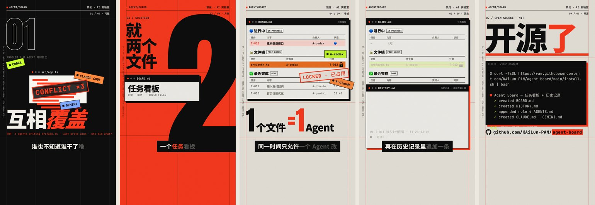
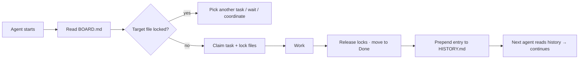

# Agent Board · Multi-Agent Task Board

> **Two Markdown files that let Codex, Claude Code, Gemini, Cursor… relay work on the same project.**
> A task board to avoid conflicts, a history log to share context. No server, no plugin, no new architecture.

[中文](README.md) · [Rule text](templates/en/RULE.md) · [Examples](examples/) · [Prompts](docs/PROMPTS.md)



```bash
curl -fsSL https://raw.githubusercontent.com/KAiLun-PAN/agent-board/main/install.sh | bash -s -- --lang en
```

## Why

When several agents touch one project, two things break:

1. **Overwrites** — agent A is halfway through a file when agent B edits it too.
2. **Lost context** — Codex finishes a step, Claude Code takes over and re-reads the whole repo; previous conclusions and pitfalls are gone.

Agent Board writes the coordination state **into files in the repo**. Every agent can read files, so every agent can "see" the others.



## The two files

| File | Purpose | Key rule |
|---|---|---|
| **`BOARD.md`** | Who is doing what, which files are locked, backlog, recently done | **Register before acting**; one agent per file at a time |
| **`HISTORY.md`** | One short entry per finished task | **Summary + pointers** only (what / why / where); follow pointers for details |

Plus a protocol block appended to `AGENTS.md` / `CLAUDE.md` / `GEMINI.md` so every agent follows it on every task. See [templates/en/RULE.md](templates/en/RULE.md).

## Install

```bash
# Chinese templates (default)
curl -fsSL https://raw.githubusercontent.com/KAiLun-PAN/agent-board/main/install.sh | bash
# English templates + Cursor / Copilot / Windsurf rules
curl -fsSL https://raw.githubusercontent.com/KAiLun-PAN/agent-board/main/install.sh | bash -s -- --lang en --all
```

The installer creates `BOARD.md` and `HISTORY.md` (never overwrites existing ones) and appends the protocol, wrapped in `<!-- AGENT_BOARD_RULE_v1 -->` markers, to the agent rule files. Re-running updates the block in place. Options: `--lang`, `--dir`, `--all`, `--board`, `--history`, `--uninstall`.

| Agent | Rule file |
|---|---|
| OpenAI Codex | `AGENTS.md` |
| Claude Code | `CLAUDE.md` |
| Gemini CLI / Google Antigravity | `GEMINI.md` (Antigravity also reads `AGENTS.md`) |
| Cursor | `AGENTS.md` / `.cursor/rules/agent-board.mdc` |
| GitHub Copilot | `.github/copilot-instructions.md` |
| Windsurf | `.windsurfrules` |

## Limits & outlook

This is a pragmatic, **for-now** approach: it relies on agents following the rules, and state is synced through files.
Future multi-agent systems will likely share context natively, at the agent-architecture or even model level. Until then, two files are enough.

## License

[MIT](LICENSE) © KAiLun-PAN
