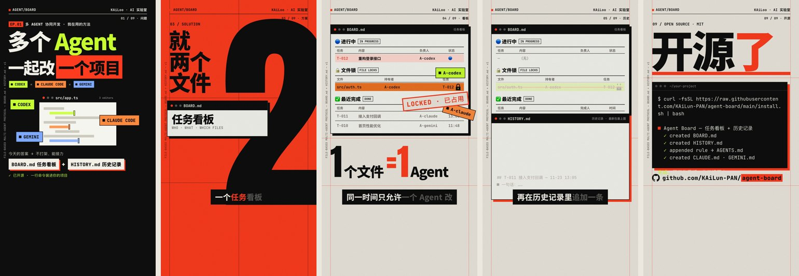
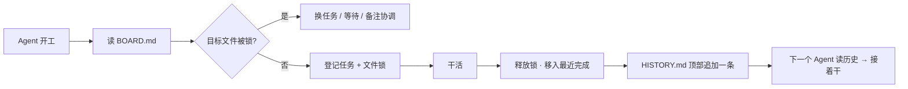

# Agent Board · 多 Agent 协同看板

> **两个 Markdown 文件，让 Codex、Claude Code、Gemini、Cursor……在同一个项目里接力干活。**
> 一个「任务看板」防冲突，一个「历史记录」传上下文。无需服务、无需插件、无需改架构。

[English](README.en.md) · [规则原文](templates/zh/RULE.md) · [实战示例](examples/) · [常用提示词](docs/PROMPTS.md)



```bash
curl -fsSL https://raw.githubusercontent.com/KAiLun-PAN/agent-board/main/install.sh | bash
```

---

## 为什么需要它

多个 Agent 同时改一个项目，最常见的两个问题：

1. **互相覆盖**：A 改到一半，B 也动了同一个文件，谁也不知道谁干了啥。
2. **上下文断裂**：Codex 做完一段，Claude Code 接手，又从头读一遍仓库，前面的结论、踩过的坑全丢了。

Agent Board 的思路非常朴素：**把协同状态写进仓库里的文件**。所有 Agent 都会读文件，于是它们就能「看到彼此」。



## 思路来源：渐进式披露

灵感来自 Skill 的**渐进式披露（Progressive Disclosure）**：Agent 不需要一次读完所有信息——先读一份很短的索引（name + description），需要时再展开正文，用到时才去读脚本和参考资料。

协作也一样：

- **看板 = 索引**：一眼看清谁在做什么、哪些文件被占用；
- **历史 = 摘要 + 指针**：每个任务只留一段摘要，细节按「详见」指针按需去读。

上下文不靠一次塞满，而是**按需逐层展开**——既省 token，又不会断。

## 两个文件

| 文件 | 作用 | 关键规则 |
|---|---|---|
| **`BOARD.md`** 任务看板 | 谁在做什么、锁了哪些文件、待办与最近完成 | **先登记，后动手**；同一文件同一时间只允许一个 Agent 改 |
| **`HISTORY.md`** 历史记录 | 每个任务完成后的摘要 | 只写**摘要 + 指针**（改了什么 / 为什么 / 产物在哪），细节按指针去找 |

再加一段写进 `AGENTS.md` / `CLAUDE.md` / `GEMINI.md` 的**协同协议**，让每个 Agent 每次任务都自动遵守。完整规则见 [templates/zh/RULE.md](templates/zh/RULE.md)，核心 8 条：

1. 先看板，后动手
2. 领任务 + 占文件
3. 文件锁独占（读不占锁）
4. 锁最小、新建优先
5. 完成即释放 → 写历史
6. 历史只写摘要 + 指针
7. 阻塞要标注，不占锁沉默
8. 要上下文先查历史，不重复全量探索

## 一键安装

在你的项目根目录执行：

```bash
# 中文模板（默认）
curl -fsSL https://raw.githubusercontent.com/KAiLun-PAN/agent-board/main/install.sh | bash

# 英文模板 + 同时写入 Cursor / Copilot / Windsurf 规则
curl -fsSL https://raw.githubusercontent.com/KAiLun-PAN/agent-board/main/install.sh | bash -s -- --lang en --all
```

安装器会：

- 新建 `BOARD.md`、`HISTORY.md`（已存在则保留，不覆盖）
- 把协同协议**追加**到 `AGENTS.md`、`CLAUDE.md`、`GEMINI.md`（用 `<!-- AGENT_BOARD_RULE_v1 -->` 标记包裹，重复执行只会原地更新，不会重复插入）
- 检测到 `.cursor/`、`.github/copilot-instructions.md`、`.windsurfrules` 时自动写入对应规则

| 参数 | 说明 |
|---|---|
| `--lang zh\|en` | 模板语言，默认 `zh` |
| `--dir <path>` | 目标项目目录，默认当前目录 |
| `--all` | 同时写入 Cursor / Copilot / Windsurf 规则文件 |
| `--board <name>` / `--history <name>` | 自定义文件名，如 `--history VERSION_HISTORY.md` |
| `--uninstall` | 移除所有规则段落（保留看板与历史） |

不想跑脚本？直接把 [`templates/zh/`](templates/zh/) 里的三个文件复制进项目即可。

## 哪个 Agent 读哪个文件

| Agent | 规则文件 |
|---|---|
| OpenAI Codex（CLI / App） | `AGENTS.md` |
| Claude Code | `CLAUDE.md` |
| Gemini CLI / Google Antigravity | `GEMINI.md`（Antigravity 也读 `AGENTS.md`） |
| Cursor | `AGENTS.md` / `.cursor/rules/agent-board.mdc` |
| GitHub Copilot | `.github/copilot-instructions.md` |
| Windsurf | `.windsurfrules` |
| 其他 / 网页版 ChatGPT | 开工前粘贴 [docs/PROMPTS.md](docs/PROMPTS.md) 里的提示词 |

## 实战效果

这套规则来自作者自己的项目，已经在真实开发里跑了几十个任务：

- **《AI视频进化史》视频生产线**：数字人、配音、动画、混音、剪映工程等多条子任务由不同 Agent 接力完成，每次迭代一条历史记录，回溯任何一版都只需要读一屏。
- **大型客户端（C++ / QML）内嵌 Agent 功能开发线**：30+ 个任务、多个 Agent 并行，靠文件锁避开高频冲突文件、靠「构建串行」规则避免同时编译互相覆盖产物。

脱敏后的看板与历史示例见 [examples/](examples/)。

## 常见问题

**和 git 分支 / worktree 冲突吗？** 不冲突，可以叠加。分支解决「代码合并」，看板解决「谁在做什么、为什么这么做」。很多 Agent 在同一个工作区里协作，并不会各开一个分支。

**看板本身会冲突吗？** 看板是「改动极小的追加/删除行」，冲突概率很低；协议要求动手前重新读一次看板。真正的高频共享文件，请在项目自己的规则里点名（例如「构建串行」「某某文件优先新建」）。

**历史记录越来越长怎么办？** 历史只写摘要和指针，最新在最上面；Agent 一般只读最近几条，需要时再搜索。可以按季度归档到 `history/`。

**为什么不用数据库 / MCP 服务？** 因为 Markdown 是所有 Agent 的最大公约数：不用装任何东西，人也能直接读、直接改。

## 局限与展望

协同依赖每个 Agent 遵守规则，状态靠文件同步。
未来的多 Agent 协同，很可能会在 Agent 架构、甚至模型层原生共享上下文。在那之前，两个文件就够用了。

觉得有用欢迎 Star ⭐，也欢迎关注作者 **KAiLoo**，分享更多 AI 技巧和方法。

## 自定义

- 想沿用已有文件名？`--board TASKS.md --history VERSION_HISTORY.md`
- 想加项目专属规则？直接在 `BOARD.md` 的「使用协议」里追加，例如付费 API 调用前必须注明、构建串行、某些目录禁止改动等。
- 多条开发线？各用一套看板（如 `BOARD.md` 与 `C2V_BOARD.md`），在规则里写清楚各自范围。

## License

[MIT](LICENSE) © KAiLun-PAN（KAiLoo）
